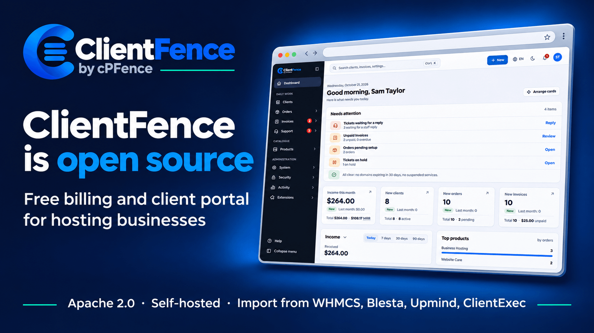

<h1>
  
</h1>

The open-source billing platform built for hosting providers.
100% free. Open source. Your infrastructure, your rules.

ClientFence is a billing and client management system for hosting businesses: invoices,
payments, orders, domains, hosting accounts and support tickets in one client area.

- **Download:** the latest release from [GitHub Releases](https://github.com/cPFence/clientfence/releases/latest)
  (the zip and its SHA-256).
- **Documentation:** [clientfence.com/docs](https://clientfence.com/docs/), from installing to
  moving from [WHMCS](https://clientfence.com/docs/getting-started/import-from-whmcs/),
  [Upmind](https://clientfence.com/docs/getting-started/import-from-upmind/),
  [Blesta](https://clientfence.com/docs/getting-started/import-from-blesta/) or
  [ClientExec](https://clientfence.com/docs/getting-started/import-from-clientexec/).
- **Demo:** [demo.clientfence.com](https://demo.clientfence.com/login) (changes are not saved).
- **Community:** [ClientFence forum](https://community.cpfence.app/t/clientfence), for setup help
  and usage questions.

## Features

- **Client area** with the Palisade theme, and an admin area with a sidebar menu, Ctrl+K
  search and a dashboard. Both come in light and dark, left to right and right to left
  (Arabic, Hebrew and Persian), in 30 languages.
- **Accounts:** authorized users with their own permissions, two-factor sign-in and
  Google sign-in; staff groups with detailed permissions and sign-in security rules.
- **Billing:** invoices with part payments, credit and part refunds, quotes, an optional
  "prices include tax" mode, EU VAT reverse charge, payment receipts, payment method fees, order
  form answers and cancellation requests. Payments through Stripe (cards and Direct Debit),
  PayPal, PayPal Auto-Pay, PayTabs, eWAY and manual gateways, with saved cards that pay
  invoices on the due date. An accounting sync sends approved invoices with their clients,
  payments and refunds to [Xero, FreeAgent or QuickBooks Online](https://clientfence.com/docs/clients-and-billing/accounting-sync/).
- **Hosting and domains:** an Enhance server manager with client pages for each hosting
  account (including Enhance backups) and a daily status check; server managers for cPanel/WHM,
  Plesk, DirectAdmin, CWP and HestiaCP; Change Product; 18 domain registrars (including Enom,
  NameSilo, Namecheap, OpenSRS, CentralNic Reseller, OVHcloud, Openprovider and Nominet) with TLD
  price sync.
- **Software licences:** licence keys with client IP limits, per-unit billing and checks
  compatible with the WHMCS Licensing Addon.
- **Support:** tickets with file attachments, email-to-ticket, ticket merge, a network status
  page, and ticket secrets: server logins a client adds to a ticket, stored encrypted and
  opened only by staff with that permission.
- **Moving from WHMCS, Upmind, Blesta or ClientExec:** an import of clients, products, services,
  domains, invoices, payments and tickets from a WHMCS, Blesta or ClientExec database, or from
  Upmind through its API.
- **Security and health:** security hardening and a system health page, built in.
- **Updates:** a daily check of the ClientFence release list on clientfence.com (it sends
  nothing about your site, and System → Update turns it off), a dashboard notice and a staff
  email for a new release, and an Update button that backs up, installs and finalizes it.
  Nothing else calls home: no telemetry, extension directory or error reports.

## Requirements

- PHP 8.3, 8.4 or 8.5 (64-bit), with the curl, dom, gd, iconv, intl, json, openssl,
  pdo_mysql, xml and zlib extensions. mbstring and OPcache are recommended.
- MySQL or MariaDB.
- Apache, LiteSpeed or OpenLiteSpeed, which read the `.htaccess` file, or Nginx with
  [its server block](https://clientfence.com/docs/getting-started/nginx/).
- Cron, to run the scheduled tasks every five minutes.

## Building a release

Build the release with Docker from the repository root:

```bash
docker buildx build --target release-artifact --output type=local,dest=build/release .
```

`build/release` then holds the files to upload.

## Installing

1. Create a MySQL or MariaDB database and a user for it.
2. Upload the release files to the document root of a domain or subdomain (not a
   subfolder). Include `.htaccess`: some upload tools skip files whose name starts with a dot.
3. Open `https://your-domain/install/` and follow the installer.
4. Do the final steps the installer shows: remove the `install` folder if it is still there,
   make `config.php` read-only and add the cron line, for example:

   ```text
   */5 * * * * php /path/to/clientfence/cron.php
   ```

## Upgrading

From the admin area: **System → Update** shows the new release and its notes; **Update
ClientFence** saves a backup of the database and the files it replaces (in
`.clientfence-backups/<site folder name>` next to the site folder), installs the release, updates the database and
signs you out. The site reopens on its own once the update is complete; only if the database
update needs attention does the admin area ask you to finalize it after signing in again. If the
release cannot be unpacked, the previous files are put back and the site keeps running the version
it ran before.

From the server, the same update as the site's user (never as root):

```bash
php console.php system:update --check   # installed and latest version; exit code 1 when an update is available
php console.php system:update           # shows the release notes and asks first; --yes for scripts, --beta for the beta channel
```

By hand:

1. Back up the database and the files (`config.php` and the `data` folder above all).
2. Upload the new release files over the old ones. Keep `config.php` and `data`.
3. Sign in to the admin area at once: it opens **Finalize update**, which applies the database
   updates; from then until you finish, visitors see a maintenance page. Or run the updates from
   the command line:

   ```bash
   php console.php system:run-patcher
   ```

System → Settings → System, System Health tab, shows "Database updates" pending until they are
applied.

## Development

[CONTRIBUTING.md](CONTRIBUTING.md) describes how to send changes. Report security issues
as described in [SECURITY.md](.github/SECURITY.md).

## License

ClientFence is released under the Apache 2.0 license. It is based on FOSSBilling; see
[LICENSE](LICENSE) and [NOTICE](NOTICE).
